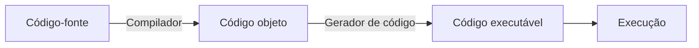
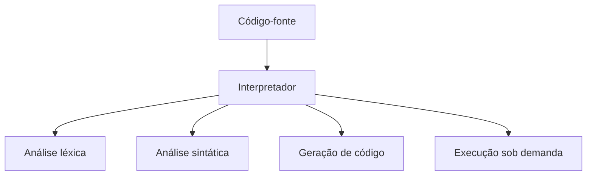
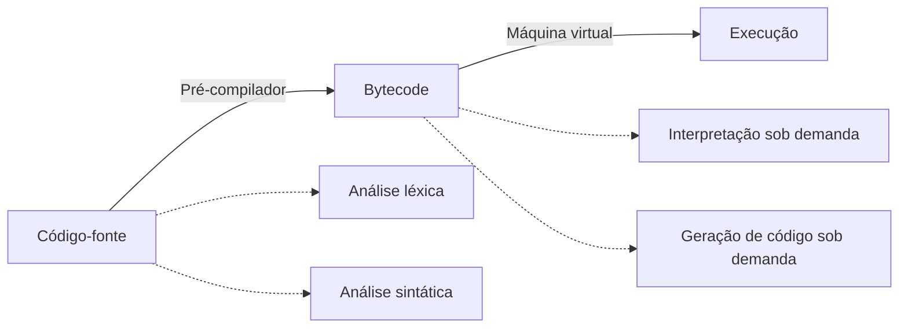

# 📘 Conceitos de Programação

> **Material de estudo** baseado nas aulas do **Prof. Dr. Nélio Alves**.

---

## 🧩 Algoritmo

Um **algoritmo** é uma sequência finita de instruções utilizadas para resolver um problema.

### 🧺 Exemplo: lavar roupa suja

**Problema:** lavar roupas sujas.

**Passos:**

1. 🧺 Colocar a roupa em um recipiente.
2. 🧴 Colocar sabão e amaciante.
3. 🚿 Encher o recipiente com água.
4. 🔄 Mexer até dissolver o sabão.
5. ⏱️ Deixar de molho por vinte minutos.
6. 🫧 Esfregar as roupas.
7. 💦 Enxaguar.
8. 🔐 Torcer.

---

## ⚙️ Automação

**Automação** consiste em utilizar máquinas para executar um procedimento de forma automática ou semiautomática.

---

## 🛠️ O que é necessário para criar um programa?

| Componente | Função |
| --- | --- |
| **Linguagem de programação** | Fornece as regras léxicas e sintáticas para escrever o programa. |
| **IDE** | Permite editar, executar e testar o programa. |
| **Compilador** | Transforma o código-fonte em código objeto. |
| **Gerador de código ou máquina virtual** | Permite executar o programa. |

---

## 💻 Linguagem de programação

Uma **linguagem de programação** é um conjunto de regras léxicas e sintáticas usado para escrever programas.

### Exemplos

`C` · `C++` · `C#` · `Java` · `Python` · `PHP` · `JavaScript` · `Ruby`

### 🔤 Análise léxica

A análise léxica verifica a correção das palavras isoladas — está relacionada à **ortografia** da linguagem.

### 📝 Análise sintática

A análise sintática verifica a correção das sentenças — está relacionada à **gramática** da linguagem.

### Comparação

| Português | Linguagem de programação |
| --- | --- |
| O cachorro está com fome. | `x = 2 + y;` |
| A cachorra está com fome. — erro gramatical | `x = + 2 y;` — erro de sintaxe |

---

## 🧰 IDE — Ambiente de Desenvolvimento Integrado

Uma **IDE** é um conjunto de softwares utilizado para construir programas.

### Exemplos

| Linguagem | IDEs populares |
| --- | --- |
| C/C++ | Code::Blocks |
| Java | Eclipse, IntelliJ IDEA, NetBeans |
| C# | Microsoft Visual Studio |

### ✨ Funcionalidades

- ✏️ Edição de código-fonte com indentação e destaque de sintaxe.
- 💡 Autocompletar.
- 🐞 Depuração e testes.
- 📦 Construção do produto final.
- 🧱 Sugestão de modelos.
- 🔧 Suporte a diversas tarefas do projeto.

---

## 📄 Código-fonte

O **código-fonte** é escrito pelo programador em uma linguagem de programação.

### Exemplo em Python

```python
print("Olá, mundo!")
```

---

## 🔨 Compilação

O compilador realiza as análises léxica e sintática antes de gerar o código objeto.



### Características

- ⚡ Gera um programa executável mais rápido.
- ✅ Permite que o compilador identifique erros antes da execução.

---

## ▶️ Interpretação

No modelo interpretado, o interpretador lê o código-fonte e executa as instruções sob demanda.



### Características

- 🔧 Facilita a manutenção de aplicativos em produção.
- ✍️ Permite maior expressividade ao escrever soluções em poucas linhas.
- 🌐 Pode permitir a execução em diferentes plataformas sem recompilar o código-fonte.

---

## 🔄 Abordagem híbrida

Algumas linguagens combinam pré-compilação e interpretação por meio de uma máquina virtual.


