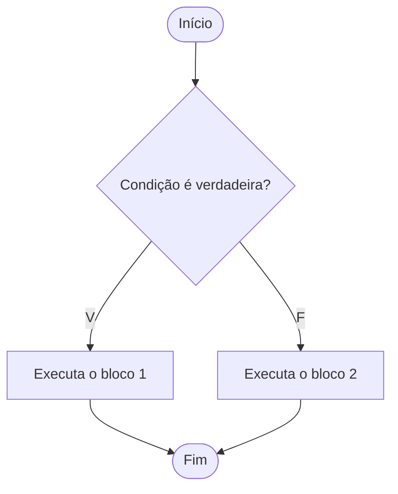

# 📘 Expressões Condicionais (if/else)

> Material de estudo baseado nas aulas do **Prof. Dr. Nélio Alves**.

# Conceito 

**Estrutura de controle** que permite definir que um certo **bloco de comandos** somente será executado dependendo de uma condição

## Fluxograma do if/else



## Sintaxe da estrutura condicional

**Simples:**
```java 
if ( <condição> ) {
    <comando 1>
    <comando 2>
}
```

> Atenção na endentação!

**Composta:**
```java 
if ( <condição> ) {
    <comando 1>
    <comando 2>
} else {
    <condição 3>
    <condição 4>
}
```
> Atenção na endentação!

## Encadeamento de estrutura condicionais

```java 
if ( <condição 1> ) {
    comando 1
    comando 2
} else {
    if ( <condição 2> ) {
        comando 3
        comando 4
    } else {
        condição 5
        condição 6
    }
}
```
> Atenção na endentação!